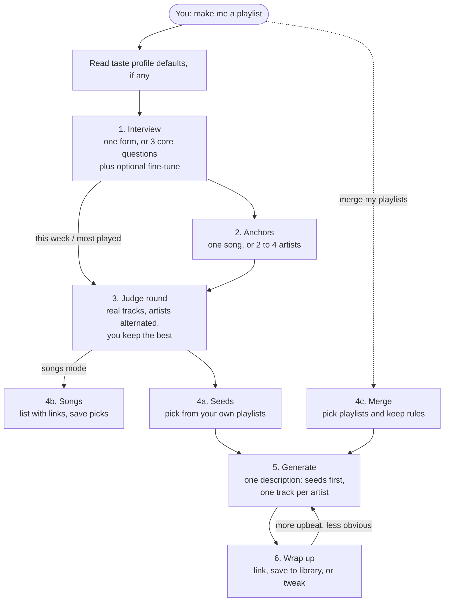

# Playlist builder for Spotify

[](https://github.com/Tiebe-Vaes/playlist-builder-for-spotify/actions/workflows/ci.yml)
[](https://github.com/Tiebe-Vaes/playlist-builder-for-spotify/releases)
[](LICENSE)
[](#claude-code)

A Claude skill that builds Spotify playlists you actually want to hear. Instead of guessing from one sentence, Claude interviews you, lets you judge real sample tracks, picks seed playlists from your library, and then writes one precise prompt for Spotify's playlist generator.


## Why

The Spotify connector in Claude can generate a playlist, but only from a single text description. Ask for "a chill playlist" and you get a generic one. This skill turns a short conversation into a description that names your artists, the exact tracks you liked, and your own playlists as seeds.

## How it works



The description it sends looks like this:

```text
Create a calm, sad acoustic playlist of about 120 minutes based on my taste and my playlists Late nights, Rainy days. Vibe like The Goo Goo Dolls (Iris), Radiohead (Fake Plastic Trees, Exit Music). Mostly songs and artists I already listen to.
```

## Install

You need the **Spotify connector** connected in Claude and a **Spotify Premium** account, since generating playlists needs Premium.

The skill works only in Claude (claude.ai, Claude Desktop and Claude Code), because it relies on Claude's Spotify connector. Other agents that read `SKILL.md` files can load it but have no connector to call. It needs no API keys, runs no scripts and makes no network calls of its own.

### Claude Code

```text
/plugin marketplace add Tiebe-Vaes/playlist-builder-for-spotify
/plugin install playlist-builder-for-spotify@playlist-builder-for-spotify
```

Connectors you add on claude.ai show up in Claude Code when you sign in with the same account.

### claude.ai

1. Download `playlist-builder-for-spotify.zip` from the [latest release](https://github.com/Tiebe-Vaes/playlist-builder-for-spotify/releases/latest).
2. In claude.ai, open **Settings → Capabilities → Skills** and upload the zip.
3. Connect Spotify under **Settings → Connectors**.

## Usage

Ask for a playlist in your own words:

- "Make me a playlist for studying tonight."
- "Build a 3 hour road trip mix, mostly stuff I know."
- "Remake that last playlist but more upbeat."
- "Find me a few songs like what I've been listening to this week."
- "I can't stop playing Nude by Radiohead, build a playlist around it."
- "Merge my playlists Late nights and Rainy days, drop the songs I'm sick of."

### Settings

Say settings in your request, set defaults in your taste profile, or answer them in the interview. On claude.ai and Claude Desktop the interview is one form with sliders, prefilled from your taste profile, and the judge round plays 30-second previews. Elsewhere it asks 3 core questions, then offers to fine-tune the rest. Anything you mention along the way ("I'm open to new artists") changes the matching setting, and Claude tells you what it changed.

| Setting | Options | Asked in | Default |
| --- | --- | --- | --- |
| Mode | playlist · songs (find songs, no playlist) · merge (combine your playlists) | from your request | playlist |
| Start from | one song · artists you name · what you played this week · your most played · a mix | core | |
| Occasion and mood | your own words | core | |
| Length | up to 12 hours | core | |
| Adventure | 1 only songs you know · 2 mostly known · 3 half and half · 4 mostly new · 5 all new, deep cuts | fine-tune | 2 |
| Songs per artist | 1 · 2 · 3 · no limit | fine-tune | 3 |
| Leave out | artists, songs or kinds of music, in your words | fine-tune | nothing |
| Seeds | your own playlists, picked from a list | always | |
| Name | your own words | form | Spotify picks one |
| Judge round | pick songs · skip | form | pick songs |

Arc (steady, build up, wind down, rise and fall) is never asked; say it in your own words ("build it up slowly") and the skill picks it up.

The same artist never plays twice in a row, whatever the songs-per-artist setting.

### Taste profile (optional)

Save your defaults, usual artists and playlists once. When the defaults cover every setting, the skill skips the interview and asks you to confirm them in one line. Copy [`taste.example.md`](plugins/playlist-builder-for-spotify/skills/playlist-builder-for-spotify/taste.example.md) to `~/.claude/spotify-taste.md` and fill it in. On claude.ai, paste it into your project knowledge instead. The skill also offers to write the file for you after your first playlist.

## Limitations

These come from the Spotify connector, not the skill. The full write-up with workarounds is in [`connector-limits.md`](plugins/playlist-builder-for-spotify/skills/playlist-builder-for-spotify/references/connector-limits.md).

| Limit | Workaround in the skill |
| --- | --- |
| One text description builds the whole playlist; no hand-placed tracks | Every round exists to write a better description |
| Vibe searches return only AI-made playlists, no tracks | Search plain artist names, "artists similar to X", or your listening history, which all return real tracks |
| Your playlists can be listed but not read | Name them in the description as seeds |
| No playback control, no adding to existing playlists | Out of scope for now; see the roadmap |
| Generating needs Spotify Premium | Clear message on free accounts, plus songs mode as a fallback |

## Repository layout

```text
.claude-plugin/marketplace.json        marketplace entry for /plugin marketplace add
plugins/playlist-builder-for-spotify/
  .claude-plugin/plugin.json           plugin manifest, single source of the version
  skills/playlist-builder-for-spotify/
    SKILL.md                           the flow Claude follows
    taste.example.md                   taste profile template
    references/                        loaded only when a step needs them
evals/                                 trigger and flow evals (skill-creator format)
scripts/check-evals.mjs                eval shape and version checks for CI
docs/                                  design notes
```

## Roadmap

- [ ] Demo GIF
- [ ] Spotify Web API fallback for users without the connector, which can also read playlist contents and add exact tracks. Design: [`docs/web-api-fallback.md`](docs/web-api-fallback.md)
- [ ] Run the flow evals in CI once a connector mock exists

## Contributing

Issues and PRs are welcome. See [CONTRIBUTING.md](CONTRIBUTING.md).

## License

[MIT](LICENSE). Not affiliated with or endorsed by Spotify. Spotify is a trademark of Spotify AB.
